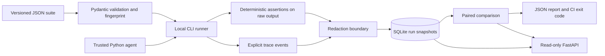

# Architecture

## Components

- `models.py`: strict schema shape, required nonempty cases/assertions and unique case IDs. Schema version and suite version are separate.
- `runner.py`: sequential execution, copied inputs, explicit seed, JSON output validation, timing, errors, trace snapshots, and fingerprinting.
- `assertions.py`: three deterministic checks without eval, code injection, or a judge.
- `redaction.py`: recursively masks configured secrets and common credential/PII patterns.
- `store.py`: connection-per-operation SQLite repository, transactional insert-only persistence.
- `compare.py`: pairing validation, case-level changes, conservative interval, explicit decision rules.
- `cli.py`: run and compare orchestration, machine-readable run IDs and report files.
- `api.py`: app factory for read-only inspection and comparison, isolated databases in tests.

## Storage and consistency

`runs(id TEXT PRIMARY KEY, created_at TEXT NOT NULL, payload TEXT NOT NULL)` stores one complete redacted JSON snapshot per run. Its payload includes suite identity/hash, declared agent revision, seed/repeats, assertion booleans, output, events, duration, and exception class for each trial. Raw cases are not stored. Whole-run inserts are atomic; crashes before completion lose the in-memory run, and failures during insertion roll back. Duplicate run IDs fail instead of overwriting baseline evidence. Schema migrations, partial-run recovery, and ingestion validation are future work.

SQLite avoids provisioning a separate service for one sequential local runner. PostgreSQL becomes appropriate with multiple workers and shared authenticated access. A JSON snapshot keeps this milestone simple but is less efficient for cross-run analytics than normalized trials and assertions.

## Decisions and limits

Evaluation and reads use the same Python comparison function, so the API and CLI share policy. The API cannot import or execute agents. Report computation is synchronous; large traces and suites are not bounded yet. Agent module loading remains a trusted-code operation. Persistent global state in agents can defeat repeat independence; the runner does not reset module globals. Durations are descriptive wall-clock timings, not performance regressions or provider costs.

Version identity and pairing prevent accidental apples-to-oranges comparisons, but user-supplied revision labels do not verify code identity. Redaction limits retained evidence; it does not make untrusted code safe. Deterministic assertions cover only properties specified by test authors, not overall answer quality.
