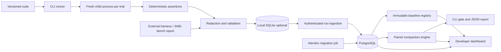

# Architecture and engineering decisions

## Boundaries

Execution is separate from serving. The CLI can write directly to a configured database or upload a redacted local record to the API. The API does not import agent modules or execute patches. A bearer token protects data operations. A static, same-origin dashboard consumes those operations with an in-memory token and uses text nodes for all untrusted evidence.

Each CLI trial runs in a new Python subprocess. stdout/stderr are suppressed, normal trace emission is bounded, output is JSON-checked, and a timeout kills the process group on POSIX. This protects the harness from ordinary hangs/global-state contamination. It is not a security boundary against malicious code, escaped descendants, native memory exhaustion, or deliberate protocol tampering. The Python `evaluate` function still supports in-process callables for trusted tests/integration; that path has no timeout.

## Persistence and migrations

- `tw_runs`: UUID primary key, timestamp, indexed suite hash, redacted JSON payload as text. Append-only via application API.
- `tw_baselines`: composite primary key `(name, version)`, foreign key to run, timestamp, redacted note. Versions are explicit, immutable, and never silently redirected.
- `alembic_version`: migration revision. PostgreSQL startup does not auto-migrate; a single deployment migration job runs first.

SQLAlchemy transactions and database uniqueness provide concurrency semantics. An identical run-ID retry succeeds idempotently. A changed payload under an existing ID fails with conflict. Concurrent creation of the same baseline version produces one winner and one conflict. Baseline references are checked and enforced by foreign keys. Stored JSON is validated before and after redaction, then sized before insertion. The client is trusted to report assertion truth: consistency checks cannot prove an external evaluator was honest.

SQLite auto-migrates for local development and tests. PostgreSQL is used for the shared service and concurrency tests. JSON snapshots preserve evidence cheaply at portfolio scale but require reading payloads for summary calculations; normalized trials and materialized summaries are the next scalability step. v0.1's `runs` table is left untouched; v0.2 uses `tw_*` tables. Export old records with v0.1 and explicitly ingest them after review if migration of historical evidence is needed.

## Error and security behavior

2 MB request and stored-run limits, 10,000 trials per run, 100 events per trial, and schema checks bound normal ingestion. CLI emission additionally limits individual event and output sizes. Request validation errors do not echo raw inputs. Database exceptions return a generic 503; readiness checks fail until tables exist. No mutation endpoints delete runs or baseline versions. Immutable here means application behavior, not tamper-proof storage: a database administrator can change records.

All results endpoints require a constant-time bearer comparison. No cookies or cross-origin access are enabled. Static assets use a strict content security policy; interactive Swagger/ReDoc pages use their required CDN assets. Shared-token authentication is intentionally simpler than a user directory and is unsuitable for tenant isolation.

## CI/CD

GitHub Actions verifies both Python versions, PostgreSQL persistence, immutable-baseline races, error/privacy boundaries, CLI gate behavior, Docker build/startup, live HTTP ingestion/comparison, and persistence after API restart. Version tags configure GHCR image publication. Deployment remains a reviewed operator step with explicit migration, health checks, TLS, backup, and rollback policy. No production availability or throughput claims have been measured.
